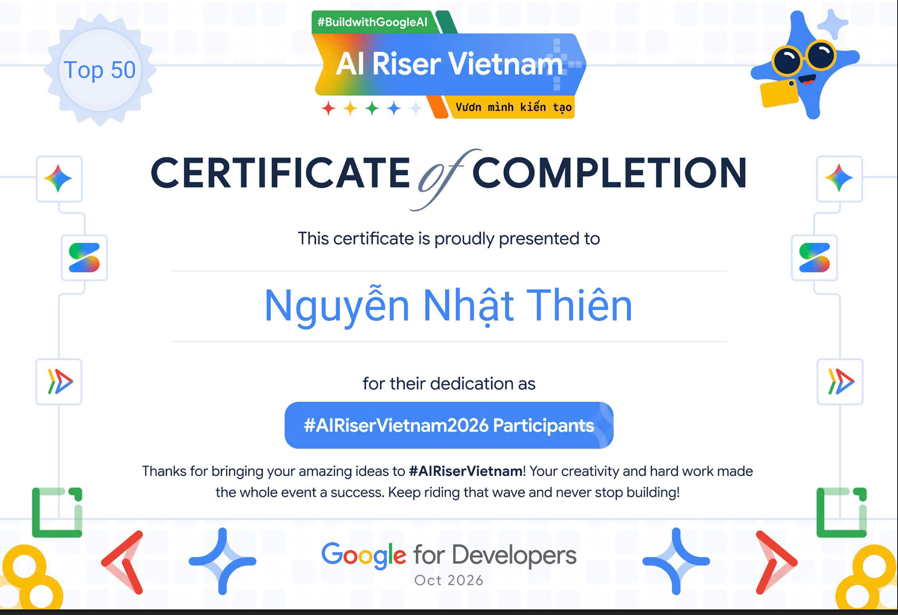
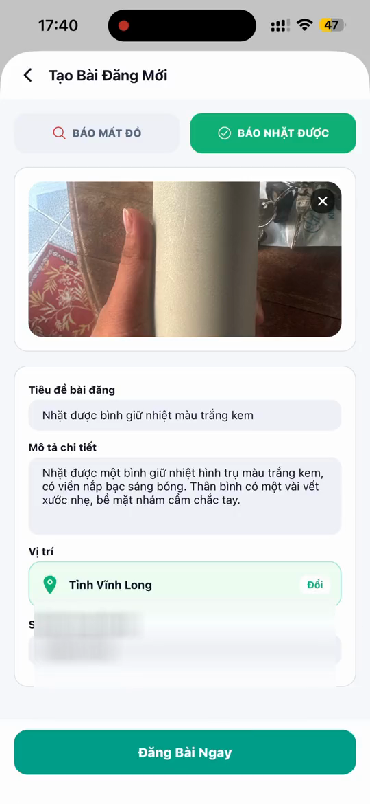
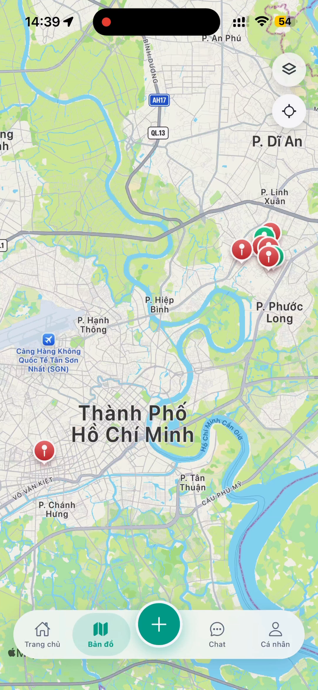
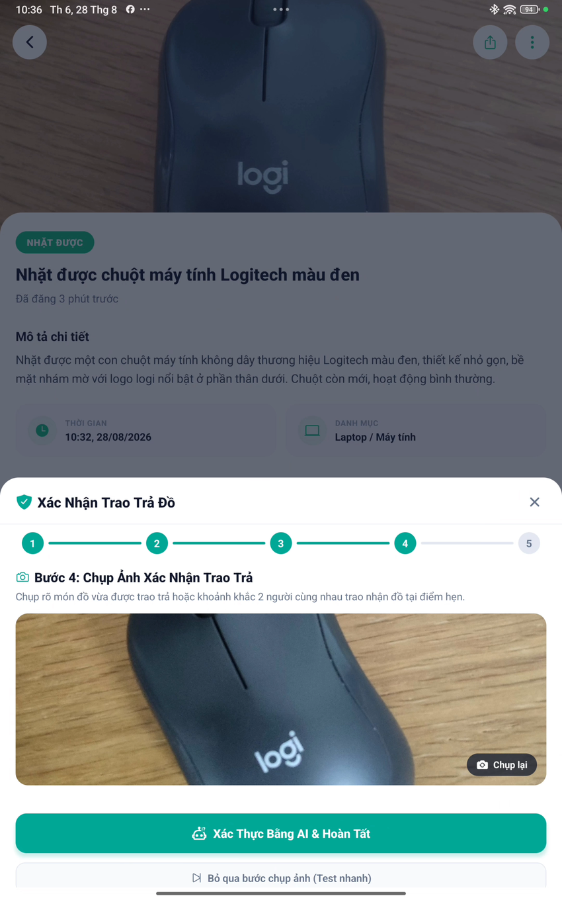
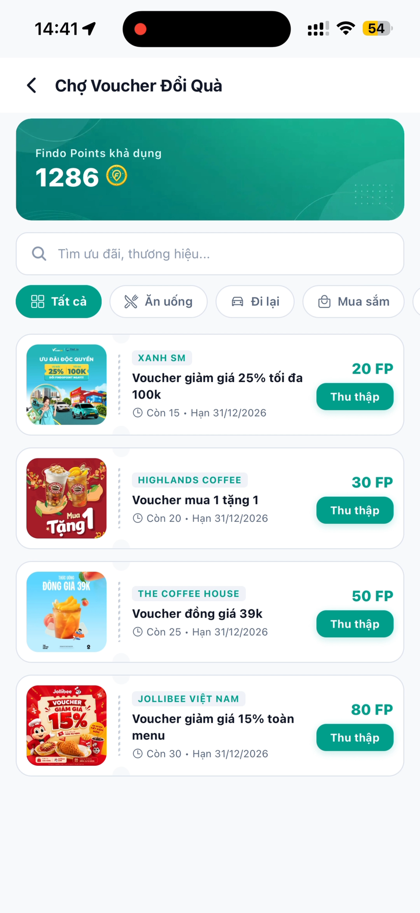

<p align="center">
  
</p>

<h1 align="center">Findora</h1>

<p align="center">
  <strong>Đồ thất lạc có thể tìm lại. Kết nối người mất và người nhặt bằng AI, bản đồ và cộng đồng.</strong><br />
  An AI-assisted lost-and-found app built to help belongings find their way home.
</p>

<p align="center">
  
  
  
  
</p>

<p align="center">
  <a href="#demo">▶ Xem demo</a> ·
  <a href="#journey">Hành trình tìm lại</a> ·
  <a href="#bắt-đầu">Cài đặt</a> ·
  <a href="https://gdg.community.dev/events/details/google-gdg-live-vietnam-presents-su-kien-kick-off-ai-riser-vietnam-2026-bien-y-tuong-thanh-san-pham/">AI Riser Vietnam</a>
</p>

---

## 🏆 Top 50 — AI Riser Vietnam 2026

Findora bắt đầu từ một niềm tin: món đồ thất lạc vẫn có thể tìm được đường về. **Nguyễn Nhật Thiên** xây ứng dụng để con đường ấy ngắn hơn — giúp người đang tìm gặp người đã nhặt, và biến một dòng tin thành cơ hội đoàn tụ.

Năm 2026, Findora được gọi tên trong **Top 50** của AI Riser Vietnam — một cột mốc đáng nhớ trên hành trình biến ý tưởng ấy thành sản phẩm hữu ích. Bạn có thể tự đối chiếu **Findora (Nguyễn Nhật Thiên)** trong [danh sách builder chính thức của chương trình](https://rsvp.withgoogle.com/events/airiservietnam/home_vietnam); chứng nhận được lưu lại ngay bên dưới.

<p align="center">
  <strong>10.000+ lượt tham gia · 750 dự án · 10 dự án Demo Day</strong><br />
  <sub>Quy mô AI Riser Vietnam 2026 theo <a href="https://dost.hochiminhcity.gov.vn/chuyen-doi-so/cong-bo-ket-qua-ai-riser-viet-nam-2026-ton-vinh-cac-giai-phap-ai-thuc-tien/">Sở Khoa học và Công nghệ TP.HCM</a>.</sub>
</p>

<p align="center">
  <a href="assets/readme/ai-riser-top50-certificate.png">
    
  </a>
</p>

---

## Findora là gì?

> Bài đăng đồ thất lạc thường nằm rải rác ở nhiều nhóm và khó tìm theo vị trí. Findora gom việc **báo mất, báo nhặt, tìm kiếm và trao trả** vào một ứng dụng di động — để người cần tìm có thể sớm gặp người đã nhặt được.

Gemini hỗ trợ phân tích ảnh và soạn thông tin bài đăng. Bản đồ giúp tìm quanh khu vực, còn hệ thống ghép đôi xếp hạng các bài có khả năng liên quan dựa trên mô tả, loại đồ, thời gian và khoảng cách.

<a id="demo"></a>

## Demo: từ thất lạc đến ngày đoàn tụ

Một món đồ thất lạc thường bắt đầu bằng câu hỏi “mình nên đăng ở đâu?”. Findora gom hành trình tìm lại vào một nơi: chia sẻ thông tin, nhìn quanh khu vực, rồi liên hệ để trao món đồ về đúng chủ.

<p align="center">
  <a href="assets/readme/findora-post-demo.mp4">
    
  </a><br />
  <sub>Đăng tin nhặt được — bấm vào ảnh động để xem video.</sub>
</p>

<a id="journey"></a>

### Một hành trình, bốn khoảnh khắc

<table>
  <tr>
    <td align="center" width="50%">
      <a href="assets/readme/findora-ui-post.png"></a><br />
      <strong>1. Kể lại điều đã xảy ra</strong><br />
      <sub>AI gợi ý tiêu đề và mô tả từ ảnh; bạn xem lại trước khi chia sẻ.</sub>
    </td>
    <td align="center" width="50%">
      <a href="assets/readme/findora-ui-map.png"></a><br />
      <strong>2. Tìm quanh mình</strong><br />
      <sub>Nhìn các tin báo mất và báo nhặt trên bản đồ, gần nơi món đồ được thấy.</sub>
    </td>
  </tr>
  <tr>
    <td align="center" width="50%">
      <a href="assets/readme/findora-ui-return.png"></a><br />
      <strong>3. Gặp nhau và trao trả</strong><br />
      <sub>Chụp ảnh lúc trao trả để hai bên cùng xác nhận món đồ đã về đúng người.</sub>
    </td>
    <td align="center" width="50%">
      <a href="assets/readme/findora-ui-rewards.png"></a><br />
      <strong>4. Lan tỏa lòng tốt</strong><br />
      <sub>Người hỗ trợ trao trả nhận điểm cảm ơn và có thể đổi ưu đãi trong cửa hàng.</sub>
    </td>
  </tr>
</table>

## Findora giúp người dùng

- **Đỡ phải tìm trong nhiều nhóm:** bài báo mất và báo nhặt được tập hợp trong cùng một ứng dụng.
- **Thu hẹp nơi cần tìm:** bản đồ giúp xem những tin gần khu vực liên quan.
- **Trao đổi rõ ràng hơn:** người mất và người nhặt có thể nhắn tin, hẹn gặp và xác nhận trao trả.
- **Ghi nhận người giúp đỡ:** điểm cảm ơn có thể đổi thành voucher ưu đãi.

## Công nghệ phía sau sản phẩm

| Lớp | Công nghệ |
|:--|:--|
| Ứng dụng | React Native 0.86 · Expo SDK 57 · Expo Router · TypeScript |
| AI | Google Gemini API — phân tích ảnh, hỗ trợ hẹn gặp và xác minh bàn giao |
| Dữ liệu & tài khoản | Firebase Authentication · Cloud Firestore · Realtime Database · Storage |
| Vị trí | `react-native-maps` · `expo-location` |
| Gọi thời gian thực | `react-native-webrtc` · Firebase Realtime Database signaling |

## Bắt đầu

### Yêu cầu

- Node.js và npm
- Android Studio hoặc Xcode nếu muốn chạy native trên thiết bị / simulator

### Cài đặt và chạy

```bash
git clone https://github.com/teehihi/findora-new.git
cd findora-new
npm install
```

Tạo file `.env` ở thư mục gốc và điền các khóa client của dự án:

```env
EXPO_PUBLIC_GEMINI_API_KEY=your_gemini_api_key
EXPO_PUBLIC_FIREBASE_API_KEY=your_firebase_api_key
```

Các giá trị Firebase còn lại được khai báo trong `src/config/firebase.ts`. `EXPO_PUBLIC_GOOGLE_MAPS_API_KEY` được dùng cho một số thao tác bản đồ. Khóa SDK Google Maps Android nằm tại `expo.android.config.googleMaps.apiKey` trong `app.json`; hãy thay bằng khóa của bạn và giới hạn theo ứng dụng trước khi phát hành.

```bash
npx expo start
```

`react-native-webrtc` cần native module, vì vậy hãy dùng development build để thử tính năng gọi thoại/video; Expo Go không bao gồm module này.

## Bảo mật cấu hình

- File `.env` đã được Git ignore. Không commit Gemini key, mật khẩu, service-account key hoặc thông tin đăng nhập máy chủ.
- Expo thay thế `EXPO_PUBLIC_*` bằng giá trị thật trong JavaScript bundle; người dùng có thể đọc các giá trị này từ bản build. Không xem chúng là bí mật. Hãy giới hạn API key và dùng backend làm proxy nếu cần giữ Gemini key riêng tư. [Expo SDK 57: biến môi trường](https://docs.expo.dev/versions/v57.0.0/guides/environment-variables/)
- Firebase client API key là cấu hình nhận diện ứng dụng; quyền truy cập dữ liệu cần được bảo vệ bằng Firebase Authentication và Security Rules. Không đưa service-account key hoặc quyền quản trị vào ứng dụng di động.

## Cấu trúc dự án

```text
src/
├── app/          # Các màn hình Expo Router: auth, tabs, bài đăng, chat, ví
├── components/   # Thành phần giao diện dùng lại
├── config/       # Firebase
├── models/       # Kiểu dữ liệu TypeScript
├── services/     # Gemini, ghép đôi, Firebase, chat và WebRTC
└── utils/        # Hàm tiện ích
assets/readme/    # Banner, chứng nhận, video demo và ảnh UI cho README
```

---

<p align="center">
  <br />
  <strong>Đồ thất lạc vẫn có đường về.</strong><br />
  <sub>Findora được xây dựng tại Việt Nam bởi <strong>Nguyễn Nhật Thiên (TEE)</strong><br />Top 50 · AI Riser Vietnam 2026</sub>
</p>

<p align="center">
  <a href="https://github.com/teehihi"></a>
  <a href="https://www.linkedin.com/in/tee21"></a>
  <a href="https://nteelab.vercel.app/"></a>
  <a href="https://linktr.ee/nkqt.tee"></a>
</p>

<p align="center"><sub>Made with care in Vietnam 🇻🇳</sub></p>
